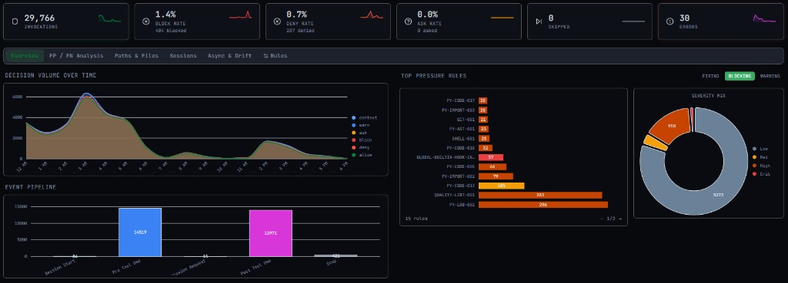

# slopgate

Global CLI guardrails engine for AI coding agents. **Real-time guardrails where the host platform supports them, plus batch code quality linting.** Claude Code has the richest runtime surface; Cursor, Codex CLI, OpenCode, and Pi are supported with platform-specific limitations.



## Install

Install [uv](https://docs.astral.sh/uv/) first, then either install the global CLI or work from a project venv.

```bash
# Global CLI on PATH (recommended)
uv tool install .

# From PyPI — published as `ai-slopgate` (the `slopgate` name was already taken)
# uv tool install ai-slopgate

# Development: project venv + dev tools
uv sync
uv run slopgate test
```

## Quick Start

```bash
# Initialize config (creates config.json in the active slopgate config dir)
slopgate config init
slopgate config path   # print the active config.json location

# Install hooks for your platform
slopgate install claude    # registers the native Claude plugin (claude plugin install)
slopgate install codex     # patches ~/.codex/hooks.json
slopgate install opencode  # copies plugin to the user OpenCode plugins dir
slopgate install pi        # registers the native Pi package (pi install)
slopgate install omp       # registers the native OMP plugin (omp plugin install)

# Or use the native all-harness installer and OS auto-updater
slopgate install all                # auto-update is on by default
slopgate install all --disable-autoupdate

# Run self-test
slopgate test

# Check stats
slopgate stats --days 7

# Lint the current project for code quality
slopgate lint check             # scan project; fail only on NEW violations (agent stop hooks)
slopgate lint strict            # fail on ANY violation (git pre-commit gate)
slopgate lint check --details   # extended violations + repair prognosis
slopgate lint init .            # scaffold slopgate.toml
```

## Dashboard

The [`dashboard/`](dashboard/) app visualizes Slopgate JSONL traces from the configured trace directory (by default `config_dir()/logs`): decision volume, top rules, sessions, harness status, and rule toggles. It complements `slopgate stats` with interactive charts, config editing, and file upload.

### Live dashboard (default: port 18834)

Build static assets with trace data baked in, deploy to the canvas directory, then run the API/static server:

```bash
# From repo root — local logs on this machine
make dashboard-build

# Or fetch logs + config from a remote host over SSH (default host: little)
make dashboard-build-ssh

# Serve UI + live APIs (snapshot, SSE stream, config read/write, harness status)
make dashboard-api
```

Open **http://192.168.50.151:18834/** on the LAN or **http://airbox:18834/** on the tailnet. The API binds to all IPv4 interfaces by default so both addresses work; set `BIND=127.0.0.1` to restrict ForceDash to local-only access.

| Variable | Default | Purpose |
|---|---|---|
| `PORT` | `18834` | HTTP listen port |
| `BIND` | `0.0.0.0` | Bind address for LAN/tailnet access (`192.168.50.151`, `airbox`) |
| `SLOPGATE_SSH_HOST` | `little` | SSH host for live logs, config, and harness APIs |
| `SLOPGATE_CONFIG_PATH` | `~/.config/slopgate/config.json` | Remote config file path used by the dashboard API |
| `SLOPGATE_TRACE_DIR` | `~/.config/slopgate/logs` | Remote trace directory used by the dashboard API |

`serve.py` serves files from `~/.openclaw/canvas/forcedash` (populated by `build-standalone.py`). Without a prior build, start `serve.py` only after `build-standalone.py` has run at least once.

### UI development (port 18835)

For frontend work without the canvas deploy path:

```bash
npm --prefix dashboard install   # or: bun --cwd dashboard install
make dashboard-dev                # Vite → http://localhost:18835
```

- Starts with **mock** data unless `window.__SLOPGATE_DATA__` is injected.
- **Drop** `.jsonl` / `.ndjson` trace files onto the UI to explore local logs.
- Rule editing and harness panels need `make dashboard-api` on **18834**; Vite proxies `/api/*` to that server.

### Trace inputs

| Source | How |
|---|---|
| Hooks (live) | `events.jsonl`, `rules.jsonl`, `results.jsonl`, `subprocess.jsonl` under `~/.config/slopgate/logs/` |
| CLI summary | `slopgate stats --days 7` (terminal; no UI) |
| Dashboard upload | Drag JSONL files in dev mode |
| Baked build | `build-standalone.py` inlines recent history into the deployed `index.html` |

## Supported Platforms

| Platform | Status | Install |
|---|---|---|
| **Claude Code** | ✅ Production | `slopgate install claude [--install-scope user\|project\|both]` |
| **Cursor** | ⚠️ Partial | `slopgate install cursor [--install-scope user\|project\|both]` |
| **Codex CLI** | ⚠️ GA hooks, coverage gaps | `slopgate install codex [--install-scope user\|project\|both]` |
| **OpenCode** | ⚠️ Degraded | `slopgate install opencode [--install-scope user\|project\|both]` |
| **Pi** | ⚠️ Partial | `slopgate install pi [--install-scope user\|project\|both]` |
| **OMP** | ⚠️ Partial | `slopgate install omp [--install-scope user\|project\|both]` |

`slopgate install all` is the multi-device path: each enrolled device installs hooks only for harnesses that already exist on that OS/user profile (a config root, a host CLI on PATH, or Slopgate's own staging counts as existing), then registers the native scheduler for that OS. Linux uses a user `systemd` timer, macOS uses a LaunchAgent, and native Windows uses `schtasks` plus a PowerShell shim. The scheduler polls the GitHub source and runs `slopgate update`, so a push to `github.com/vasceannie/slopgate` refreshes the installed package when each device is online. Package-only updates leave native registrations and staged payloads alone; run `slopgate update --refresh-hooks` to restage and re-register them (for Pi the one staged package is shared by user and project scope, so a refresh changes its code for both while enablement and filters stay per scope). Use `--include-missing` only when intentionally creating every supported harness config on that device. Pass `--disable-autoupdate` to skip the scheduler.

## Agent bundle

The [`bundle/`](bundle/) directory is the repo-owned source of truth for Slopgate-facing agent assets that are safe to share across harnesses: recovery skills, rule shards, prompt fragments, Claude agents, and MCP templates.

Local development flow:

```bash
./bundle/scripts/link-local.sh --dry-run  # review symlink targets
./bundle/scripts/link-local.sh            # link skills/rules/agents only
slopgate install all                      # hook files remain CLI-owned
./bundle/scripts/verify-local.sh
```

Important ownership boundary: the bundle **does not** symlink full prompt entrypoints (`~/.claude/CLAUDE.md`, `~/.codex/AGENTS.md`, `~/.config/opencode/AGENTS.md`) and does **not** own Claude/Codex/Cursor `hooks.json` or Claude `settings.json` hook commands. Keep hook wiring under `slopgate install ...` so install/uninstall can merge safely, back up user config, and point at the correct local binary.

The package-managed prompt sync commands are `slopgate bundle sync-prompts` and `slopgate bundle uninstall-prompts`.

For Claude Code marketplace work, `bundle/claude-plugin/` is a plugin-shaped tree and `bundle/marketplace/` is a local marketplace catalog. Build/test locally with:

```bash
./bundle/scripts/build-claude-plugin.sh --copy
claude --plugin-dir ./bundle/claude-plugin
```

## Platform Notes

Installation modes: Claude Code and OMP register native plugins and Pi a native package through each host's own local package manager. OpenCode (auto-discovered plugin, not a native package install), Codex CLI and Cursor (native hooks, not a registered plugin) keep their existing mechanisms because no supported local, non-interactive, scope-preserving plugin install route exists for them; each installer prints an `Installation mode:` line. Native registration is separate from activation: follow each host's own reload/trust guidance, and a native registration that is disabled or not yet trusted is reported but never silently enabled.

- **Claude Code**: full first-class hook target, registered as the native plugin `slopgate-enforcement@slopgate-runtime` through a local Slopgate-owned marketplace (`claude plugin install --scope user|project`; confirm with `claude plugin list --json`). Install moves Slopgate-owned hooks out of `~/.claude/settings.json` and/or `.claude/settings.json` only after native registration is verified, preserving unrelated hooks and settings; start a new Claude session (and check `/hooks`) to confirm it loads. Session startup hooks cover `startup`, `resume`, `clear`, `compact`, and `fork`; Slopgate uses Claude's `hookSpecificOutput` permission and `decision`/`reason` shapes per the [hooks reference](https://code.claude.com/docs/en/hooks).
- **Cursor**: native hooks via `~/.cursor/hooks.json` (user) and/or `.cursor/hooks.json` (project). Install with `slopgate install <platform>` (user default), `--install-scope project|both`, and optional `--project-root /path/to/repo`. The same flags apply to `install all`, `setup`, `update`, and `uninstall`. Slopgate maps Cursor events to its canonical model and renders Cursor-native stdout (`permission` gates, `continue` for `beforeSubmitPrompt`, `additional_context` for `postToolUse`/`afterFileEdit`, `followup_message` for `stop`/`subagentStop`). Post-tool hooks cannot hard-block edits the way Claude `PostToolUse` denial does; use `preToolUse`, `beforeShellExecution`, or `beforeReadFile` for enforcement. Tab hooks (`beforeTabFileRead`, `afterTabFileEdit`) are installed for inline-completion policy; `workspaceOpen` is not wired yet.
- **Codex CLI**: GA hooks with platform-specific gaps via `~/.codex/hooks.json` and/or `.codex/hooks.json`; the installer keeps `features.hooks = true` in the adjacent `config.toml` for compatibility. Matchers cover all Codex-supported local function and MCP tools, while hosted tools such as `WebSearch` remain outside the hook path. After installation or refresh, run `/hooks` in Codex to review and trust the changed hook definitions. Post-tool critical blocks use Codex's top-level `continue`/`stopReason`; other findings use `hookSpecificOutput.additionalContext` or `decision`/`reason` per the [Codex hooks reference](https://developers.openai.com/codex/hooks).
- **OpenCode**: the OpenCode 2.2.5 V2 plugin is installed in the user config plugins directory and/or `.opencode/plugins/slopgate-plugin.ts`; these are host auto-discovered local-plugin locations. The implementation follows the [OpenCode V2 plugin migration guide](https://opencode.ai/v2/docs/build/plugins/migrate-v1/) and the pinned native tool declarations in `node_modules/@opencode/plugin/dist/promise/tool.d.ts`. `tool.execute.before` is the only hard pre-execution mutation control. `tool.execute.after` receives completed or error outcomes after execution and can report advisory or unknown mutation evidence, but cannot reject or roll back the edit; when a post-tool check blocks, Slopgate adds the reason, and the recovery steps if repair is armed, to the result the model reads. Public event data is filtered to the matching plugin-instance location; session-scoped tool hooks resolve session directories, and the event subscription stops through abort cleanup. Stop findings remain advisory; generic events and permission spellings are version-sensitive. OpenCode exposes typed session/tool APIs, but no documented prompt-blocking contract, so prompt guidance remains advisory.
  Slopgate classifies OpenCode tools by exact host tool ID. Declared read-only tools remain available, declared effectful tools are forwarded to the normal policy engine, and undeclared tools are allowed with a logged warning and global safety rules still applying, so custom and MCP tools keep working. Undeclared tools are blocked during `REPAIR_REQUIRED`. During `REPAIR_REQUIRED`, only declared read-only tools, `write`/`edit`/`patch`, the dedicated repair verifier, the outer Code Mode `execute` call (the host runs the hook again for each tool it calls, so those stay gated individually), and an exact `slopgate lint check` command are allowed; opaque wrappers and compound shell commands remain blocked. A program's `fetch` has no tool hook, so a `permission.evaluate` hook denies it during repair, or when repair state cannot be read in a strict repo, while the direct `webfetch` tool stays available. Repair state is scoped to the project worktree, so sessions opened in a subdirectory share it. Mutation paths resolve like the host's: relative to the session directory with `~` expanded, and rejected when they land outside the managed repository. A generation whose recorded targets cannot be verified (for example a blocking finding that names no file) stays armed until an operator clears it explicitly with `slopgate repair clear --generation <generation>`; that command is outside the agent-facing allowlist.
  At install time Slopgate records the host runtime version from `opencode --version` separately from declared, locked, and installed `@opencode/plugin` metadata under the OpenCode config directory. Those metadata files describe local dependency state; they do not replace verification of the host SDK/runtime that loads the plugin. The generated plugin logs a per-load plugin instance ID, plugin directory, host app version, resolved binary, and install identity through structured console output. No health or version request runs on the per-hook path. The [machine-readable regression matrix](tests/fixtures/opencode_hook_contract_matrix.json) separates documented, typed, pinned-source, locally observed, and unresolved behavior.
  Native V2 mutations use `write({path, content})`, `edit({path, oldString, newString, replaceAll?})`, and `patch({patchText})`; native command execution is `shell({command, workdir?})`. Patch projection follows the pinned [2.2.5 implementation](https://github.com/anomalyco/opencode/blob/v2.2.5/packages/core/src/tool/plugin/patch.ts), including sequential sections and moves that replace existing destinations, while preserving original preimage fingerprints and inspecting intermediate writes. Reinstall the plugin after upgrading: V1 hook objects, hashline edits, and V1 projection payloads are not supported, and a V2 host refuses to load a V1 plugin, leaving enforcement off with only a log warning. `slopgate check` warns on stderr when it finds one. OpenCode keeps one plugin per ID, so with both user and project installs the user copy stays active and the project copy reports `Duplicate plugin ID: slopgate`. OpenCode supplies the runtime SDK; do not install a private SDK copy beside the plugin.
  Slopgate's awaited post-mutation latency target and reproducible benchmark are documented in [OpenCode mutation-hook latency](docs/opencode-mutation-latency.md). The target is Slopgate-owned and is not an upstream OpenCode timeout or SLO.
- **Pi**: registered as the native Pi package `pi-slopgate` (a Slopgate-owned package staged under its user data directory, added with `pi install [-l]`; confirm with `pi list`). Install requires Pi 0.74.0 or newer, the first release whose extension loader provides the `@earendil-works/*` modules the package imports; older Pi, 0.74.0 pre-releases, and `pi --version` output that is not a bare semver are refused before staging or registration. Existing package declarations and resource filters are left untouched on refresh, project scope may need your trust approval in Pi (Slopgate never passes trust flags), and a Slopgate-owned legacy `extensions/pi-slopgate/` or `slopgate.ts` copy is migrated away only after registration is verified. Start a new Pi session after install. Native events (`tool_call`, `tool_result`, `tool_execution_end`, `user_bash`, `input`, `before_agent_start`, `turn_end`, and `agent_end`) are forwarded into Slopgate's canonical model. Blocking is strongest at `tool_call`, where Pi supports `{ block: true, reason }` and mutable `event.input` for argument patches; `user_bash` blocks are returned as synthetic failed shell results because Pi's user-bash hook is an interception surface, not the same block schema as model tool calls. The `input` event can return Pi's documented handled action for blocked prompts. Post-tool findings attach Slopgate metadata through Pi's `tool_result` patch shape, while visible Slopgate activity is sent as compact custom chat messages instead of footer/status widgets or routine stderr output.
- **OMP**: registered as the native plugin `omp-slopgate@slopgate-runtime` through a local Slopgate-owned marketplace staged under Slopgate's user data directory (`omp plugin install --scope user|project`; confirm with `omp plugin list --json`). Install migrates a Slopgate-owned legacy `extensions/omp-slopgate/` copy only after native registration is verified; native disabled state is preserved and never silently re-enabled, and `uninstall` removes only the selected scope's registration. Start a new OMP session after install. Native events (`tool_call`, `tool_result`, `user_bash`, `user_python`, `input`, `session_start`, `session_stop`, `turn_end`, `agent_end`) are forwarded into Slopgate's canonical model (`tool_call`, `user_bash`, `user_python` to `PreToolUse`; `input` to `UserPromptSubmit`; `session_stop` to `Stop`; `tool_result` to `PostToolUse` or `PostToolUseFailure` via `isError`; `turn_end` to `TurnEnd`). Blocking is strongest at `tool_call` and `input` with native `{ block, reason }` and `{ handled, reason }` shapes. `session_stop` findings request an OMP continuation turn via `{ continue, additionalContext }`, capped at 8 per session, and OMP's `stop_hook_active` flag is honored to avoid continuation loops. `user_bash` and `user_python` blocks are returned as synthetic failed shell results. Tool-input rewriting is best-effort and off by default (set `SLOPGATE_OMP_INPUT_REWRITE=1`); it applies only to proven Bash inputs. Post-tool findings attach Slopgate metadata through OMP's `tool_result` patch shape. See [the OMP adapter doc](docs/adapters/omp.md) for the full event map, harness usage, and known limitations.

## Architecture

```
┌─────────────┐  ┌─────────────┐  ┌─────────────┐  ┌─────────────┐  ┌─────────────┐  ┌─────────────┐
│ Claude Code  │  │   Cursor    │  │  Codex CLI  │  │  OpenCode   │  │     Pi      │  │     OMP     │
│settings.json│  │ hooks.json  │  │ hooks.json  │  │ TS plugin   │  │ native pkg  │  │ marketplace │
└──────┬──────┘  └──────┬──────┘  └──────┬──────┘  └──────┬──────┘  └──────┬──────┘  └──────┬──────┘
       │                │                │                │                │                │
       └────────────────┴────────────────┴────────────────┴────────────────┴────────────────┘
                                                  ▼
                                       ┌────────────────────┐
                                       │  slopgate handle   │
                                       │  --platform X      │
                                       └─────────┬──────────┘
                                                 ▼
                                       ┌────────────────────┐
                                       │   Rule Engine      │
                                       │ 87 hook rules      │
                                       │ (42 Py + 45 regex) │
                                       └─────────┬──────────┘
                                                 ▼
                                       ┌────────────────────┐
                                       │  Platform Adapter  │
                                       │  (per-platform)    │
                                       └────────────────────┘
```

OpenCode is translated to a TypeScript plugin; Pi registers a native package; OMP registers a native marketplace plugin.

No shell wrappers. No bootstrap scripts. Just `slopgate handle` on PATH.

## CLI

### Hook runtime

```bash
slopgate daemon [--socket PATH] [--max-requests N] [--workers N | --serial]
slopgate handle [--platform claude|cursor|codex|opencode|pi|omp|unknown]
slopgate handle-async
slopgate replay --payload fixture.json [--platform claude|cursor|codex|opencode|pi|omp|unknown] [--pretty]
```

`slopgate handle` is the entrypoint that platform hooks invoke. `slopgate daemon` runs the optional resident Unix-socket server, and `handle-async` runs post-edit jobs when a platform supports them.

The daemon proxy is a same-host Unix-socket fast path with direct CLI fallback;
it is not a network proxy. See [`docs/remote-proxy-server.md`](docs/remote-proxy-server.md)
for the retained alterations, deployment boundary, and remote-server transport notes.

### Repo enrollment and status

```bash
slopgate check [path]
slopgate enroll [path] [--no-worktrees]
```

`slopgate check` reports whether a path is enrolled, relaxed, skipped, or not enrolled. `slopgate enroll` writes the repo marker and can include git worktrees.

### Install / update / lifecycle

```bash
slopgate install <claude|cursor|codex|opencode|pi|omp|all> [--dry-run] [--source URL] [--disable-autoupdate] [--include-missing] [--interval-minutes N] [--install-scope user|project|both] [--project-root PATH]
slopgate uninstall <claude|cursor|codex|opencode|pi|omp|all> [--dry-run] [--disable-autoupdate] [--install-scope user|project|both] [--project-root PATH]
slopgate setup [--dry-run] [--source URL] [--disable-autoupdate] [--include-missing] [--interval-minutes N] [--install-scope user|project|both] [--project-root PATH]
slopgate update [--dry-run] [--source URL] [--include-missing] [--refresh-hooks] [--install-scope user|project|both] [--project-root PATH]
slopgate migrate [path] [--dry-run] [--force] [--user-only] [--repo-only]
```

`install all` only targets harnesses that already exist unless `--include-missing` is set. `--disable-autoupdate` skips the periodic package updater.

### Activity, config, and self-test

```bash
slopgate stats [--log results.jsonl] [--days N] [--json] [--baseline-policy HASH] [--candidate-policy HASH] [--baseline-guidance HASH] [--candidate-guidance HASH] [--cohort DIM=VALUE]
slopgate eval --pack PATH [--limit N] [--pretty] [--verbose] [--include-label-only]
slopgate config show
slopgate config init [--force]
slopgate config path
slopgate test [--list] [--smoke | --since REF | --files PATH ...] [--runner COMMAND] [-- RUNNER_ARGS ...]
slopgate version
```

Offline eval packs and gold fixtures: see [docs/eval-dataset.md](docs/eval-dataset.md) (full corpus in sibling `~/repos/slopdata`).

### Bundles and semantic search

```bash
slopgate bundle sync-prompts [--dry-run] [--remove] [--only all|claude|codex|opencode|cursor|pi] [--install-scope user|project|both] [--project-root PATH]
slopgate bundle uninstall-prompts [--dry-run] [--only all|claude|codex|opencode|cursor|pi] [--install-scope user|project|both] [--project-root PATH]
slopgate search <init|doctor|models|use|list|add|query|remove|sync|reindex|completions> ...
isx <command-or-query>  # compatibility entry point for `slopgate search`
```

### Batch code quality linting (project-local)

```bash
slopgate lint check [--details|--verbose]
slopgate lint strict [--details|--verbose]
slopgate lint test-integrity [--details|--verbose]
slopgate lint freeze [path]
slopgate lint init [path]
slopgate lint update [path] [--dry-run]
```

`slopgate lint baseline` is intentionally disabled. `lint check` fails only on new violations; `lint strict` fails on any violation. `lint freeze` is the one-time baseline snapshot while `baselines.json` is empty.

Set the lint baseline file under `[paths]` in `slopgate.toml` (relative paths are resolved from the repo root):

```toml
[paths]
baseline_path = "baselines.json"
```

`slopgate lint check` prints the resolved baseline path in its header and **syncs `baselines.json` after each run**: on a clean pass it mirrors current findings (dropping stale ids); when NEW violations block the gate it only prunes fixed debt (never auto-adds NEW ids). Run `slopgate lint freeze` once while `rules` is still empty for initial enrollment. Listed stable IDs remain real defects to fix — not permission to ignore them.

#### 38 batch lint detectors

Separate from hook rule IDs: `slopgate lint check` runs these AST/static detectors project-wide (baseline-gated). The real-time hook `QUALITY-LINT-001` reuses the same detector engine on touched files after edits.

| Category | Detectors |
|---|---|
| **Parse** | python-parse-error |
| **Code smells** | high-complexity, long-method, too-many-params, deep-nesting, god-class, oversized-module, oversized-module-soft |
| **Type safety** | banned-any, type-suppression |
| **Exception safety** | broad-except-swallow, silent-except, silent-datetime-fallback |
| **Test smells** | long-test, eager-test, assertion-free-test, assertion-roulette, conditional-assertion, fixture-outside-conftest |
| **Test integrity** | untested-production-code, missing-integration-test, hypothesis-candidate, obsolete-or-deprecated-test, weak-test-assertion, mock-theater, schema-bypass-test-data, hand-built-test-payload, mocked-integration-test |
| **Duplication** | semantic-clone, repeated-magic-number, repeated-string-literal, repeated-code-block, duplicate-call-sequence |
| **Logging** | direct-get-logger, wrong-logger-name |
| **Stale code** | deprecated-pattern |
| **Wrappers** | unnecessary-wrapper |
| **Style** | long-line |

## Config Discovery

slopgate resolves config in this order:

1. `$SLOPGATE_CONFIG` (explicit file path)
2. `config_dir()/config.json`, where `config_dir()` resolves from `$SLOPGATE_CONFIG_DIR`, then native Windows `%APPDATA%\slopgate`, then `$XDG_CONFIG_HOME/slopgate`, then `~/.config/slopgate`
3. `$CLAUDE_HOOK_LAYER_ROOT/.claude/hook-layer/config.json` or `$HOOK_LAYER_ROOT/.claude/hook-layer/config.json` (legacy)
4. `~/.claude/hooks/enforcer/.claude/hook-layer/config.json` (legacy default)
5. Bundled defaults

Trace and prompt-root discovery use `$SLOPGATE_ROOT` first, then the config directory, then the legacy hook-layer roots.

Per-repo overrides live in `slopgate.toml` in the repo root.

## Rules

Slopgate has **three surfaces** that are easy to conflate:

| Surface | Count (bundled defaults) | When it runs |
|---|---:|---|
| **Real-time hooks** | **87** rule evaluations | Agent tool events (`slopgate handle`) |
| ↳ Python classes | 42 (3 always-on + 39 repo-strict) | Path/git/AST quality, post-edit lint bridge, stop/session, LangGraph, etc. |
| ↳ Regex (`config.json`) | 45 | Pattern rules for Python/TS/Rust/shell/git/config paths |
| **Batch lint** | **38** detectors | `slopgate lint check` (project-wide, baseline-gated) |

Many IDs overlap *by design* (for example `PY-CODE-013` in hooks and `god-class` / wrapper detectors in batch lint). The dashboard “top rules” chart is dominated by high-volume hook IDs such as `QUALITY-LINT-001` (post-edit touched-file lint), `PY-LOG-002`, and `PY-CODE-013` — not by the older “30 + 39” inventory.

Repo mode still applies: **outside_repo** runs only the 3 always-on safety rules; **repo_strict** (with `slopgate.toml`) runs the full 87; **repo_relaxed** drops repo-strict families but keeps always-on safety.

### Real-time hook rules (42 Python + 45 regex)

- **Always-on (3):** protected paths, sensitive data, system paths
- **Workflow & quality (repo-strict):** full-file read, git `--no-verify`, search reminders, post-edit quality commands, `QUALITY-LINT-001` / `QUALITY-POST-001`, baseline guard, enrollment, hook-infra protection, rulebook security, config-change guard, session/stop controls, bash error reinforcement
- **Python AST (19):** `PY-AST-001`, `PY-CODE-008`–`018`, `PY-EXC-001`/`002`, `PY-IMPORT-001`–`003`, `PY-LOG-002`, `PY-TEST-005`, etc.
- **LangGraph (3):** state reducers, mutation, deprecated API
- **Regex (45):** type/exception/logging/test/shell/QA-path/TS/Rust patterns in bundled `defaults.json` (override via `~/.config/slopgate/config.json`)

Availability depends on platform support:

- **Claude Code**: widest runtime coverage
- **Cursor**: partial — native `hooks.json` with Cursor-specific stdout shapes; strongest blocking on `preToolUse`, `beforeShellExecution`, and `beforeReadFile` (post-tool hooks are advisory/context-only, not hard blocks like Claude `PostToolUse` denial)
- **Codex CLI**: currently limited by Codex's narrower hook surface
- **OpenCode**: mediated through plugin event translation with advisory gaps around prompt and stop control
- **Pi**: mediated through extension event translation; strongest blocking on `tool_call`, with lifecycle and post-tool gaps where Pi only supports result patches or advisory extension behavior
- **OMP**: mediated through OMP-native extension events; strongest blocking on `tool_call` and `input`, stop enforcement via `session_stop` continuation (capped), and best-effort bash-only input rewriting off by default

### Batch lint (38 detectors)

- See the **38 batch lint detectors** table under Code Quality Linting
- Configured per repo via `slopgate.toml`; only *new* violations fail the gate
- Repo-wide baseline regeneration is disabled to prevent agents from normalizing technical debt

### Declarative regex rules (45)

Configured in `config.json` (`regex_rules` in bundled defaults) — covers Python/TS/Rust quality and test patterns, shell bypasses, QA path protection, linter config guards, git reminders, and more. Disable or downgrade per rule via `disabled_rules` / `severity_overrides`.

## Per-Repo Overrides

Create `slopgate.toml` in your repo root:

```toml
[slopgate]
# Disable specific rules
disabled_rules = ["PY-CODE-013", "PY-TEST-004"]

# Downgrade rules to advisory
[slopgate.severity_overrides]
"PY-CODE-008" = "warn"

[thresholds]
max_method_lines = 80
max_params = 6
max_complexity = 15
max_nesting_depth = 5
max_line_length = 140
```

## Enforcement Modes

slopgate now enforces in two layers using `slopgate.toml` as the enrollment signal:

- **outside_repo**: no `slopgate.toml` in the current working repo root. Only always-on safety rules run.
- **repo_strict**: `slopgate.toml` exists and the repo is enabled. Always-on safety + full strict/project rules run.
- **repo_relaxed**: `slopgate.toml` exists, but `.noslopgate`, `.no-slop-gate`, or `[slopgate].enabled = false` is set. Only always-on safety rules run.

Always-on safety protections are:

- `BUILTIN-PROTECTED-PATHS`
- `GLOBAL-BUILTIN-SENSITIVE-DATA`
- `GLOBAL-BUILTIN-SYSTEM-PROTECTION`

`skip_paths` no longer bypasses the engine. Matching paths only suppress the repo-strict rule family; always-on safety still runs.

To place a repo into relaxed mode locally:

```bash
touch .noslopgate
```

Or in `slopgate.toml`:

```toml
[slopgate]
enabled = false
```

## Windows / PowerShell Notes

- Native Windows installs use the standard console scripts generated by Python
  packaging (`slopgate.exe`, `vfc.exe`, and `isx.exe`).
- Installed hook commands are quoted through a PowerShell-compatible launcher
  on Windows so paths with spaces under `AppData` can execute reliably.
- PowerShell commands are inspected for common file operations such as
  `Set-Content`, `Add-Content`, `Out-File`, `Copy-Item`, `Move-Item`, and
  `Remove-Item`.
- OpenCode plugin installs use `%APPDATA%\\opencode\\plugins` on native
  Windows and bake the discovered `slopgate.exe` path into the generated
  plugin with JSON/TypeScript-safe escaping. `SLOPGATE_BIN` can still override
  it at runtime.
- Codex CLI hook support on native Windows depends on the installed Codex
  version. When Codex hooks are unavailable or degraded on Windows, use WSL or
  Git Bash for runtime enforcement and use `slopgate lint check` natively for
  batch quality checks.
- A `claude.bat`/`claude.cmd` that forwards to WSL (`wsl [-d <distro>] [-u
  <user>] claude %*`, by bare name or quoted path, quoted option values
  included) is detected: the installer reads Claude's state and `~/.claude`
  from that distribution and user, and the installed hook command forwards
  `WSL_DISTRO_NAME` and its own user (`SLOPGATE_WSL_USER`) through `WSLENV`.
  Only payloads that carry the distribution are translated: as that user,
  the distribution resolves each Linux path field (`realpath -m`, so symlinks
  and `..` resolve as they do for the tool) and maps it with its own
  `wslpath -w` (custom automount roots included), in one `wsl` call per hook.
  If the user is missing or the distribution cannot answer (including a path
  no process can receive, such as one with a NUL), the payload is never
  evaluated: `PreToolUse` and `PermissionRequest` get a deny decision, other
  events exit 1 with the reason on stderr. Payloads without `WSL_DISTRO_NAME`
  come from hosts running natively on Windows and are evaluated as sent; hook
  commands installed for a WSL Claude before this forwarding existed must be
  reinstalled.
- Installer containment treats NTFS junctions like symlinks: install and
  uninstall refuse any path that crosses a junction below the selected root.
- `slopgate handle` decodes hook stdin as UTF-8 (a BOM is accepted) regardless
  of the console code page, so non-ASCII project paths work without
  `PYTHONUTF8=1`.
- On Python builds without `socket.AF_UNIX`, a configured
  `SLOPGATE_DAEMON_SOCKET` cannot be reached: `slopgate handle` logs a
  warning and falls back to in-process evaluation. The resident daemon
  itself still requires Unix sockets.
